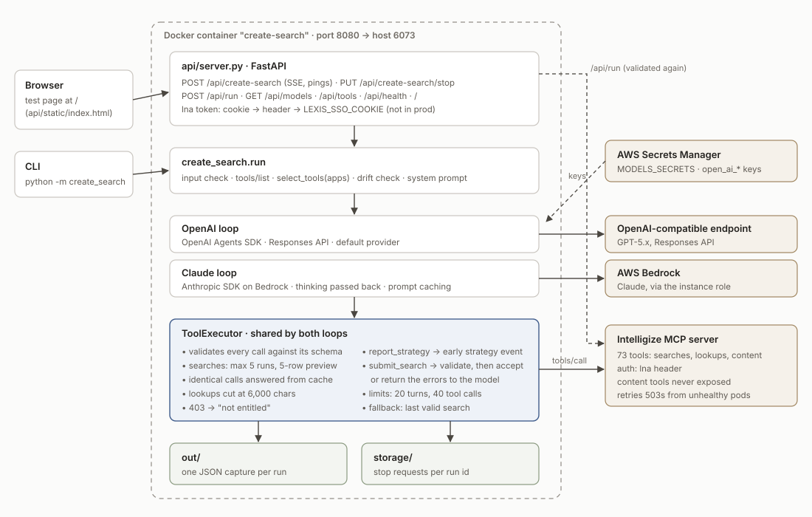
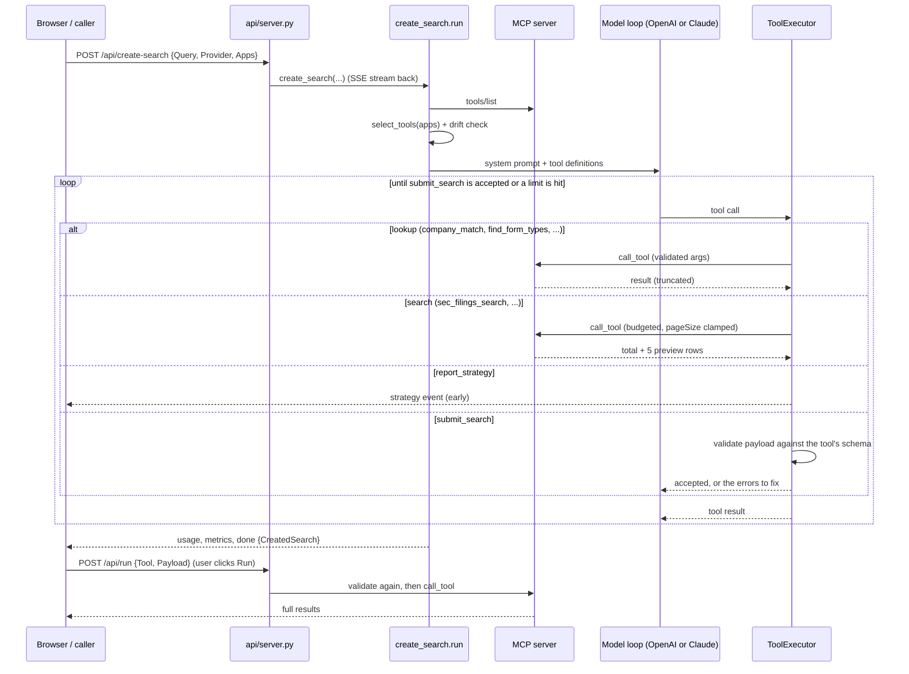

# Agentic Create Search: solution overview

**Status (2026-11-04):** built and tested against the live MCP server with scripted
models. The first run with a real model happens on the deploy host, where the OpenAI
keys are read from Secrets Manager. Deployment steps are in [DEPLOY.md](DEPLOY.md).



---

## 1. What it does

A user describes the documents they want, for example *"8-Ks of Apple filed this
year"*. The agent turns that into **one executable search** against the Intelligize
MCP server, plus:

- a **search strategy**: two to five plain sentences on which dataset, which filters
  and why;
- **analysis instructions** for whatever reads the returned documents;
- the **assumptions** it made and any **unresolved conditions** (parts of the
  request no filter can express).

The deliverable is the search payload, not the results. The agent may run a few
searches while it builds, to check that its filters return something sensible, but it
only sees a 5-row preview. The full search runs only when the user clicks **Run**
(`POST /api/run`).

## 2. How a request runs



1. **Input check.** Empty or wordless requests are rejected before any model call.
2. **Tool selection.** The server advertises one flat list (73 tools today). Bundles
   are built from the tool-name prefix: the shared `company_*` / `common_*` lookups,
   plus one bundle per requested app (default **SF + AOE**; `ALL` for every bundle).
   Tools that read document content (`*_get_full_content`, `vault_*`, ...) are never
   exposed. SF + AOE gives the model 18 tools, about 12k tokens of schema, compared
   with about 37k for all 73.
3. **Drift check.** If the server renames or adds a tool that the classification
   does not cover, the run emits a warning instead of silently changing behaviour.
4. **Model loop.** The model calls tools until it submits. Every call goes through the
   shared `ToolExecutor` (section 4).
5. **Result.** The stream ends with `usage`, `metrics` and `done`. The `done` message
   is the `CreatedSearch` (section 7).

## 3. Components

| Path | Role |
|---|---|
| `api/server.py` | FastAPI app: SSE endpoint, stop, run, models, tools, health; serves the test page |
| `api/static/index.html` | Test page: request, live strategy/reasoning/tool calls/steps, editable payload, Run |
| `create_search/run.py` | Entry point `create_search(query, provider, apps, token, ...)`; picks the loop |
| `create_search/core/toolset.py` | Bundles, the search / content / lookup classes, `drift()` |
| `create_search/core/executor.py` | Runs every tool call: validation, budget, clamping, trimming, dedupe, submit |
| `create_search/core/contract.py` | `CreatedSearch`, and the `submit_search` / `report_strategy` definitions |
| `create_search/core/validate.py` | jsonschema validation with fix-oriented messages ("unknown field ... valid fields: ...") |
| `create_search/core/limits.py` | Wrap-up notice before the turn limit; submit reminder |
| `create_search/core/prompt.py` + `create_search/prompts/system.txt` | System prompt (date, apps, rules) |
| `create_search/core/recorder.py` | Per-step timings and tokens; writes each run to `out/` |
| `create_search/loops/openai_loop.py` | OpenAI Agents SDK, Responses API (the long-term runtime) |
| `create_search/loops/claude_loop.py` | Own loop on the Anthropic SDK via Bedrock (can be removed later) |
| `create_search/mcp_connection.py` | `MCPServerStreamableHttp` on a pooled HTTP/2 transport, `lna` auth header |
| `create_search/models.py` | OpenAI keys from Secrets Manager (`MODELS_SECRETS`); Claude client |

The old POC (`shared/`, `agent_*`, `ui/`) still sits beside it, unchanged, and can be
served instead with `APP_MODULE=ui.server:app`.

## 4. Guardrails

All guardrails are enforced in code. The prompt asks the model to be economical; the
executor makes sure it is.

| Guardrail | Default | Behaviour |
|---|---|---|
| Argument validation | always | Every call is checked against the tool's schema before it reaches MCP; errors go back to the model |
| Search budget | `MAX_SEARCH_RUNS=5` | Further searches are refused with "submit your best valid payload" |
| Preview size | `SEARCH_PREVIEW_ROWS=5` | `pageSize` is clamped; the model sees the total plus 5 rows |
| Lookup size | `MAX_LOOKUP_CHARS=6000` | Long lookup output is cut |
| Repeated calls | always | An identical call is answered from the earlier result |
| Entitlement | always | A 403 is reported to the model as "not entitled" rather than as an error to retry |
| Turn limit | `MAX_TURNS=20`, `WARN_BEFORE=3` | A wrap-up notice 3 turns early, then a hard stop |
| Tool-call limit | `MAX_TOOL_CALLS=40` | Hard stop |
| No submit | `MAX_SUBMIT_REMINDERS=2` | A reply without `submit_search` gets a reminder, twice |
| Fallback | always | If a limit ends the run, the last search the agent ran successfully is returned with `source: "fallback"` and an unresolved condition saying so |
| Content tools | always | Never exposed to the model |
| Run gate | always | `/api/run` validates again and only runs search tools |

## 5. Model providers

| | OpenAI (default) | Claude |
|---|---|---|
| Runtime | OpenAI Agents SDK, Responses API | Own loop on the Anthropic SDK (`AsyncAnthropicBedrockMantle`, the Bedrock Messages API) |
| Credentials | AWS Secrets Manager, `MODELS_SECRETS` (as agentv4); `OPENAI_API_KEY` locally | AWS credential chain (instance role) |
| Default model | `DEFAULT_OPENAI_MODEL_KEY` / `gpt-5.4-2026-03-05` | `anthropic.claude-opus-5-5` |
| Reasoning | Reasoning summaries streamed as `reasoning` events | Adaptive thinking, effort from the request, summaries streamed; thinking blocks passed back between turns; a `refusal` stop ends the run with a warning |
| Caching | Provider-side | `cache_control` on the system prompt and tool list; cached tokens counted |

Both loops share the executor, the contract, the limits and the events, so they behave
the same. The Claude loop avoids three agentv4 bugs found during the review: thinking
blocks were dropped, the tool list was not cached, and cached tokens were not counted.

## 6. API

| Method | Path | Purpose |
|---|---|---|
| POST | `/api/create-search` | Body `{Query, Id?, Provider, Model?, Apps?, Effort}`; streams SSE events, with a `ping` every 5 s of silence |
| PUT | `/api/create-search/stop?id=` | Stop the run started with that `Id` |
| POST | `/api/run` | Body `{Tool, Payload}`; validates, then runs the search; 422 with `validation_errors` if invalid |
| GET | `/api/models` | Models per provider and the defaults |
| GET | `/api/tools?apps=SF,AOE` | The tools a request with those apps would see |
| GET | `/api/health` | `{"ModuleName": "Create Search Agent"}` |
| GET | `/` | The test page |

**Auth** follows agentv4: the `lna` token comes from the `lna` cookie, then the `lna`
header, then (outside `ENV=prod`) `LEXIS_SSO_COOKIE`. With `ENV=prod`, API docs are
off.

**Events** have the shape `{"kind": ..., "message": ...}`:

| kind | message |
|---|---|
| `status` | Progress line |
| `strategy` | Search strategy (`final: false` early, `true` on submit) |
| `reasoning` | Model reasoning / thinking text |
| `trace` | A tool call or a tool output |
| `step` | One timed model or tool step: `{step, kind, label, ms, input_tokens, cached_tokens, output_tokens}` |
| `warning` | Something degraded; the run continues |
| `usage` | Token totals (JSON string, as agentv4) |
| `metrics` | Totals: `total_ms, model_ms, tool_ms, model_calls, tool_calls`, tokens |
| `done` | The `CreatedSearch`; `duration` in seconds |
| `agenterror` / `stop` / `ping` | Failure / stopped on request / keep-alive |

## 7. Output contract

```json
{
  "strategy": "Apple Inc. (CIK 0000320193) 8-K current reports filed since 1 January 2026...",
  "tool": "sec_filings_search",
  "payload": { "companyCik": ["0000320193"], "formTypes": [6], "dateFrom": "01/01/2026" },
  "analysis_instructions": "For each 8-K, identify the reported event...",
  "assumptions": ["\"This year\" read as calendar 2026."],
  "unresolved_conditions": [],
  "notes": "",
  "validation_errors": [],
  "source": "agent",
  "runnable": true
}
```

`runnable` is true only when a search tool is named, the payload is an object and it
passed validation. `source` is `"agent"` when `submit_search` was accepted,
`"fallback"` when a limit forced the last valid search, and `null` when there is
nothing to run.

## 8. Configuration

All settings are environment variables (see `.env.example`):

- **MCP:** `LEXIS_SSO_COOKIE` (dev token), `MCP_SERVER`, `MCP_TIMEOUT`, `MCP_RETRY_ATTEMPTS`
- **OpenAI:** `MODELS_SECRETS`, `DEFAULT_OPENAI_MODEL_KEY`; locally `OPENAI_API_KEY`
- **Claude:** `CLAUDE_BACKEND` (`bedrock`, `bedrock-invoke` or `anthropic`), `DEFAULT_CLAUDE_MODEL`, `CLAUDE_THINKING` (`adaptive`), `AWS_REGION`
- **Local only:** `USE_SYSTEM_CERTS=1` trusts the OS certificate store, for laptops behind TLS inspection
- **Limits:** `MAX_TURNS`, `WARN_BEFORE`, `MAX_TOOL_CALLS`, `MAX_SEARCH_RUNS`, `SEARCH_PREVIEW_ROWS`, `MAX_LOOKUP_CHARS`, `MAX_SUBMIT_REMINDERS`
- **App:** `ENV`, `APP_MODULE`, `CAPTURE_DIR` (`out`), `STORAGE_PATH` (`storage`)

## 9. Deployment

Docker, same image and port as before: `docker compose up -d --build`, published on
host port **6073**. The container starts `api.server:app`. Full steps, smoke tests
and troubleshooting are in [DEPLOY.md](DEPLOY.md).

## 10. Testing

| Test | What it proves |
|---|---|
| `python -m tests.test_executor_live` | Real MCP calls without a model: lookups, search budget, preview, dedupe, argument rejection, submit validation, fallback |
| `python -m tests.test_claude_loop_scripted` | Claude loop end to end with a scripted model: thinking passed back, caching set, rejected submit returned as an error |
| `python -m tests.test_openai_loop_scripted` | OpenAI loop end to end with a scripted model: submit reminder, run ends on an accepted submit |

All three pass against the live MCP server. The test page was also checked in a
browser with the scripted Claude model: streaming, strategy, steps, created search,
Run, and a rejected edited payload.

## 11. Open items

- **First real model run** happens on the deploy host (needs `MODELS_SECRETS` and Bedrock access).
- **No analysis endpoint yet.** The page has no Analyze button; analysis instructions are returned for the existing analysis API to use.
- **The POC is still in the repo.** Remove `shared/`, `agent_*` and `ui/` once the new agent matches it.
- **Watch the drift warnings.** The server has renamed tools before; `SEARCH_TOOLS` in `core/toolset.py` is the list to update.
